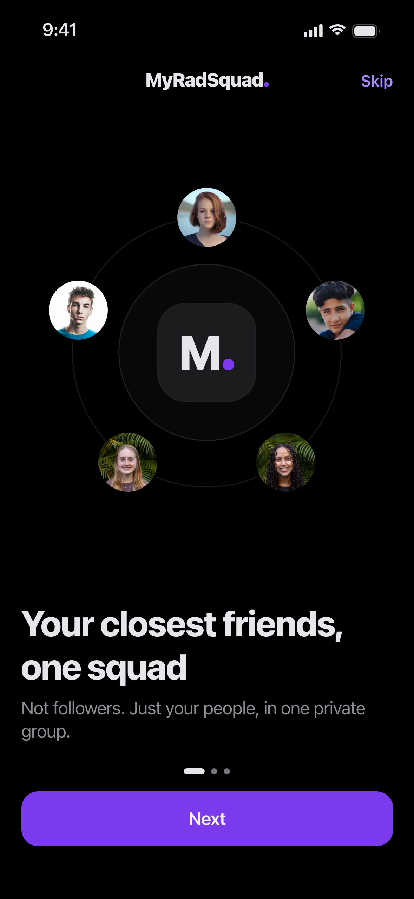
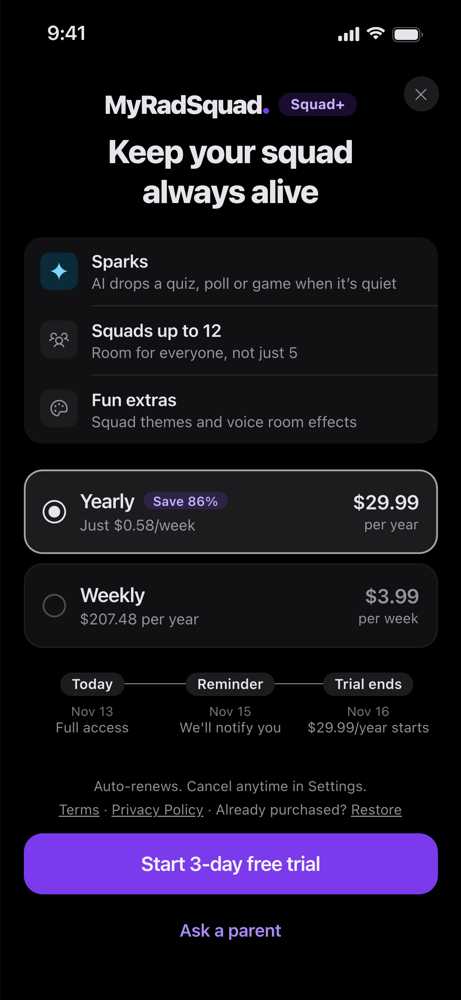
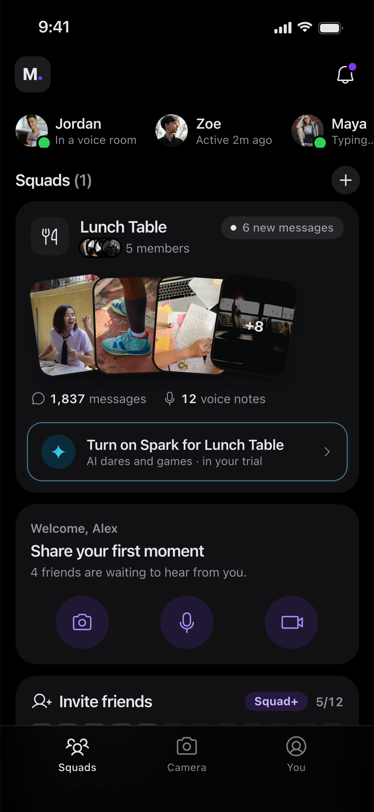
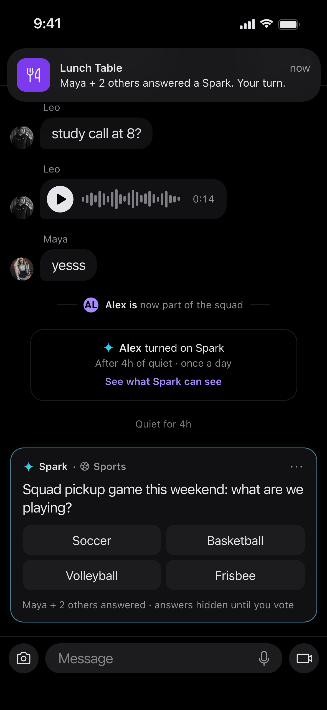

# MyRadSquad

A tappable iOS prototype of a squad chat app for teens (13–17), built for a product design case.
Design and every product decision by Canan Diren. Code written with [Claude Code](https://claude.com/claude-code).

**Live prototype:** [myradsquad.vercel.app](https://myradsquad.vercel.app) (best on a phone)

<p>
  
  
  
  
</p>

## What's inside

- **Onboarding:** three intro screens, a friend's invite, a 13+ age gate, a "why are you here?" question and a payoff screen that earns the paywall.
- **Squad+ paywall, A/B:** variant A lists the benefits with a trial timeline; variant B lets you play with Spark cards. Same price, same default plan, one variable.
- **Home:** designed for a user who finished onboarding two minutes ago: friends' presence, the squad card, a first-moment prompt.
- **Spark, the AI feature:** drops polls, games and photo dares when the chat goes quiet. Two states: the member who turns it on, and what the rest of the squad sees.
- **Trust by design:** what Spark can and can't see, a visible "turned on Spark" note, topic-only labels, and swap / snooze / remove for everyone.

The AI content is canned; there's no backend.

## How it was made

I led the design and iterated in short loops with Claude Code: describe a change, check it on a real phone, refine. Every decision and the reason behind it is logged in [DECISIONS.md](DECISIONS.md) (100+ entries: layout, motion, copy, WCAG contrast, the experiment).

- [`prototype/`](prototype): React 19, Vite, Tailwind CSS v4, Framer Motion, Phosphor icons
- [`screens/`](screens): every screen exported at iPhone size
- [`spark-components/`](spark-components): the Spark components as PNGs

## Run it locally

```bash
cd prototype
npm install
npm run dev
```

Useful URL parameters: `?screen=paywallB`, `?screen=chatSquad`, `?screen=home&plan=trial`. A "Screens" drawer on the phone's right edge jumps to every state.
